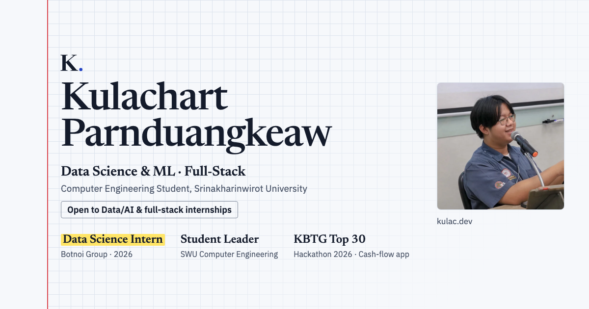

# Kulachart Parnduangkeaw — Portfolio



Personal portfolio and resume of **Kulachart Parnduangkeaw**, a Computer Engineering student at Srinakharinwirot University focused on Data Science & ML and full-stack development.

**Live site:** https://kulac.dev

## Highlights

- **Shared content.** The website and PDF CV use [`src/data.ts`](src/data.ts). Regenerate the CV after content edits. CI checks the source HTML and PDF checksums.
- **Design system.** A "lab notebook" look built on design tokens in [`src/styles/tokens.css`](src/styles/tokens.css), with light and dark themes. [`DESIGN_SYSTEM.md`](DESIGN_SYSTEM.md) explains every token and the rules for using them.
- **Interactive projects.** Filter projects by technology, or select a skill to jump to the projects that use it.
- **Project pages.** Every project has its own page at `/projects/<id>` with the approach and how it works, plus technical decisions and screenshots or photos where available. The build writes real HTML for each one (title, description, canonical URL and Open Graph tags), so shared links preview correctly.
- **⌘K command palette.** Jump to any section, copy the email, download the CV, or open GitHub/LinkedIn from the keyboard.
- **Accessible.**
  - Semantic landmarks and headings
  - Skip link and visible focus states
  - Screen-reader hints for links that open a new tab
  - WCAG AA contrast in both themes
  - Full `prefers-reduced-motion` support
- **Light on motion.** All text is readable at once except the hero name, which writes itself in about a second (screen readers get the full name immediately). Decorative effects are mostly CSS (scroll-driven where the browser supports it) and only change properties that don't affect layout (transform, opacity, filter, backgrounds and drawn strokes), so nothing shifts. Framer Motion loads through `LazyMotion` after the first render and only animates things that follow a click (toast, project filter, hero track lens, skill views); fade-ins are CSS, so content stays visible even if that chunk fails to load.
- **Share-ready.** The build includes Open Graph previews, JSON-LD, a sitemap and `robots.txt`. Project pages with a lead screenshot use that screenshot as their preview. An HTML summary and the CV link stay available if the app cannot start.

## Tech stack

React 19 · TypeScript · Vite 7 · Tailwind CSS v4 with design tokens · Framer Motion · Newsreader and IBM Plex Sans (self-hosted)

## Getting started

Requires Node.js 22.18 or later, because the generator scripts run TypeScript directly (`.nvmrc` pins Node 22). GitHub Actions runs lint, `check:tokens`, `check:data`, the CV sync check, build and browser smoke tests on every push and pull request.

```bash
npm install
npm run dev           # http://localhost:5173
npm run build         # type-check + production build into dist/
npm run preview       # serve the production build locally
npx playwright install webkit  # install the WebKit smoke-test browser
npm run test:smoke    # after build, test dist/ in Chrome and WebKit (CHROME_PATH for a custom Chrome install)
npm run lint
npm run check:tokens  # find Tailwind default classes that the design tokens turned off
npm run check:data    # find untagged skills, missing highlights, index.html values out of sync with data.ts, out-of-range chart data, and missing, unknown-id or over-budget images
npm run photos        # crop activity photos from the local, uncommitted Picture/ into src/assets/images/experience/<id>/
npm run shots         # capture project demo screenshots into src/assets/images/projects/<id>/ (append -- <id> for one)
```

Run `check:tokens` after UI changes. `tokens.css` turns off Tailwind's default colors, font sizes, fonts, radii and shadows. Tailwind doesn't report an unknown class; it just generates no CSS for it, so lint and build still pass while the page breaks.

## Updating content

1. Edit [`src/data.ts`](src/data.ts). It holds the profile, projects, experience, skills, and education. See the owner decisions in AGENTS.md before changing facts that have already been settled.
2. Regenerate the PDF CV with `npm run cv`. It produces a two-page overview across AI / Data, web, mobile and leadership. The script validates both A4 pages before replacing `src/assets/Kulachart-Parnduangkeaw-CV.pdf`. Commit it together with `src/assets/cv.sha256`. CI verifies both the current HTML and the PDF file against the saved checksums.

   `CV_PROJECTS` and `CV_LEADERSHIP` in [`scripts/build-cv.ts`](scripts/build-cv.ts) pick the entries by id, and the `cv*` fields in `data.ts` (`cvSummary`, `cvKeyResults`, `cvSkills`, `cvBullets`, `cvTrack`, …) hold CV-only wording that the website ignores.
3. Regenerate the link-preview image with `npm run og` after changing any of these:
   - the name, `focus`, `role`, `school`, `availability` or `siteUrl`
   - the first three `highlights`
   - the profile photo
   - a color used by the preview or `design/logo/k-serif.svg`

   The output is `public/og-image.png`.

`npm run cv`, `og` and `shots` use headless Google Chrome. If Chrome isn't in its default location, set `CHROME_PATH`.

A new skill or project tag also needs an entry in [`src/config/skillFamilies.ts`](src/config/skillFamilies.ts), or it is listed under Tools; `npm run check:data` catches this. To show a logo for it, add one to [`src/config/skillLogos.ts`](src/config/skillLogos.ts).

## Project structure

```
src/
├── data.ts                 # all website + CV content
├── styles/tokens.css       # design tokens: colors, type, spacing, radii, shadow, motion
├── index.css               # base styles and decorative utilities built on the tokens
├── config/
│   ├── experienceMedia.ts # photos and videos per experience or project id
│   ├── projectMedia.ts     # screenshots and gallery per project id
│   ├── sections.ts         # section ids/labels shared by nav, ⌘K palette, and scroll-spy
│   ├── skillFamilies.ts    # skill → family (ML / DL, Data, Full-stack, Languages)
│   └── skillLogos.ts       # brand logo paths from Simple Icons, loaded as a separate chunk
├── sections/               # Hero, Projects, Experience, Skills, Education, Contact
├── components/             # Navbar, CommandPalette, ProjectPage, LabFigure, Lightbox, Toast, Section, Logo, SkillLogo, icons, …
├── lib/                    # hooks and helpers: theme, router, scroll-spy, clipboard, highlighter, …
├── types/                  # type declarations (CSS custom properties in `style`)
└── assets/                 # generated CV, images/ (profile, experience, projects) and videos/
scripts/                    # CV PDF, og:image, photo and screenshot generators, token and data checks
design/logo/                # source files of the Serif K. logo
DESIGN_SYSTEM.md            # what every token means and how to use it
```

## Browser support

The CSS targets Tailwind v4’s baseline of Safari 16.4+, Chrome 111+ and Firefox 128+. The smoke suite exercises current Chrome and Playwright WebKit. Check the minimum Safari release on a device when changing dialogs, focus or CSS.

## Deployment

The site is deployed on Vercel with the Vite preset (build command `npm run build`, output `dist/`). Each push to `main` triggers Vercel immediately. CI runs independently, so pass the local checks before pushing. The local preview exercises the build. Use a Vercel Preview deployment to verify rewrite, 404 and download headers before release if those settings change.
